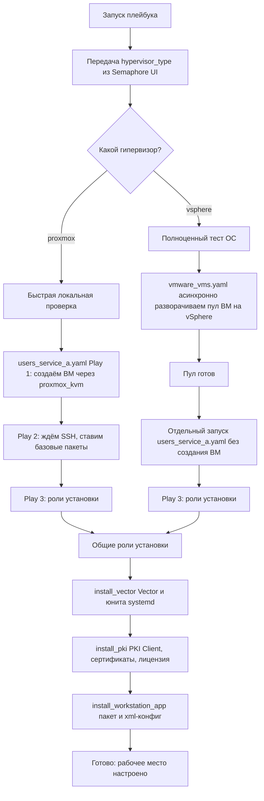

# Ansible + Semaphore UI (demo)

## Описание

Демонстрационный репозиторий со структурой Ansible-проекта: плейбуки, роли и инвентари, предназначенные для запуска через [Semaphore UI](https://semaphoreui.com/).

Все данные (хосты, пользователи, имена ролей) — вымышленные и приведены для иллюстрации структуры. Реальные значения заменены плейсхолдерами.

## Структура
```
├── ansible.cfg
├── inventory
│   ├── group_a
│   └── group_b
│     ├── services
│     │   └── workstation_hosts.yaml
│     └── users
│         ├── user_one_hosts_list.yaml
│         └── user_two_hosts_list.yaml
|
├── playbooks
│   ├── group_a
│   └── group_b
│       └── group_b_project_playbook.yaml
|
├── roles
│   └── role_one
│       ├── defaults
│       ├── files
│       │   └── file_for_copy_to_host.sh
│       ├── handlers
│       │   ├── main.yml
│       │   └── role_handlers.yaml
│       ├── README.md
│       ├── tasks
│       │   ├── main.yml
│       │   └── role_task.yaml
│       └── vars
│           ├── main.yml
│           └── role_vars.yaml
|
└── vars
    ├── group_a
    ├── group_b
    |    └── group_b_project_general_vars.yaml
    └── global_vars.yaml
```

## Основные компоненты

**`ansible.cfg`**  
Конфигурация Ansible: пути к каталогам ролей и плейбуков, параметры подключения, поведение по умолчанию.

**`inventory`**  
Инвентари с описанием целевых хостов. Два подхода к организации:
- **По пользователю** (`users/`) — инвентарь перечисляет машины, закреплённые за конкретным пользователем, и используется для персональной настройки.
- **По сервису** (`services/`) — инвентарь перечисляет машины, общие для всех пользователей, и используется для групповой настройки.

**`playbooks`**  
Плейбуки, которые описывают последовательность настройки компонентов окружения. Разложены по группам хостов.

**`roles`**  
Роли Ansible — описывают задачи без привязки к конкретному хосту или проекту, чтобы их можно было переиспользовать в разных плейбуках.

Шаблон роли создаётся командой:
```bash
ansible-galaxy init your_role
```
Документация по каждой роли — в её собственной директории (roles/<name>/README.md).

**`vars`**  
Глобальные для проекта переменные, разложенные по группам хостов.

## Принцип работы ролей и плейбуков, представленных в репозитории


